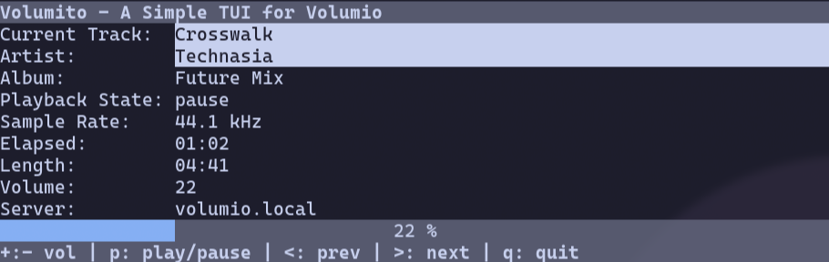
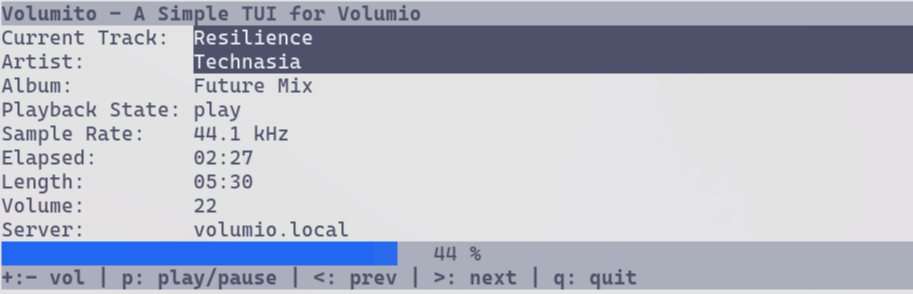

# volumito
A TUI remote controller for Volumio

## Requirements
   - Linux/MacOS (tested with alacritty)
   - Python3
   - Volumio (tested with v4+)

## Install
After cloning this repository execute the below. On startup, Volumito discovers
Volumio units advertised on the local network and connects to the first one it
finds. Press `h` to choose another discovered unit. A `~/.config/volumito/config.yaml`
is created or updated with the selected host and reused on later starts. Use
`m` to browse the Music menu: `Enter` opens folders or plays a track, and `Esc`
goes back one level. Press `f` to add the current track to Volumio favorites;
web radios are saved to radio favorites. Press `t` to toggle mute. Use `u` to
show or hide the playlist, `up` and `down` to select a queued track, and `[` or
`]` to seek backward or forward 30 seconds.
```bash
python -m venv venv
source venv/bin/activate
pip install -r requirements.txt
python volumito.py
```

## Screenshots



